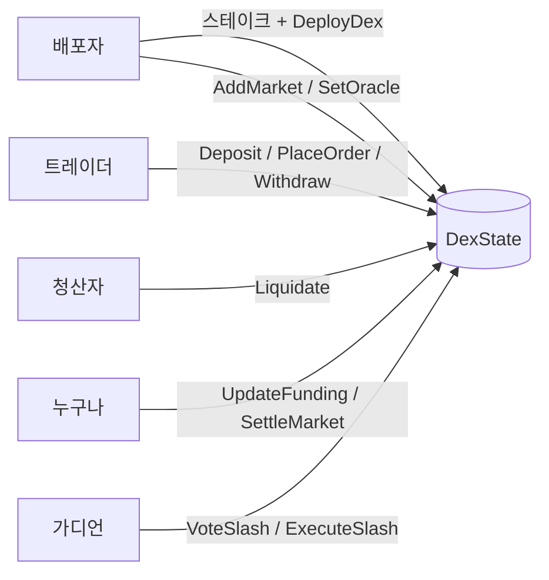

# Machine Execution Exchange (MEE)

솔라나 위의 **HIP-3 스타일 perp DEX 프로그램**.
배포자가 스테이크를 걸고 자기 perp DEX(주식, 원자재 등)를 열 수 있다. **오더북, 매칭, 증거금, 청산, 펀딩, 정산이 전부 프로그램 하나 안에** 들어 있다.
체결은 같은 트랜잭션 안에서 바로 정산되고 crank가 없다. Percolator 같은 외부 perp 인프라는 쓰지 않는다.

| 구성 | 경로 | 설명 |
|---|---|---|
| 엔진 | [`crates/mee-core`](crates/mee-core) | 솔라나 의존성 없는 순수 Rust. 오더북, 매칭, 증거금, 청산, 부실채권, 펀딩, 정산, 배포자 스테이크/슬래싱 |
| 프로그램 | [`programs/mee`](programs/mee) | 솔라나 프로그램. 계정 검증, PDA 볼트, SPL Token CPI, 명령 25개 |
| 설계 문서 | [`docs/ARCHITECTURE.md`](docs/ARCHITECTURE.md) | HIP-3 대응표, 계정 구조, 회계 공식, 수명주기, 한계 |

## 흐름 한눈에



## 실행

```bash
cargo test --workspace        # 엔진 + 프로그램 E2E (solana-program-test)
cargo clippy --workspace --all-targets
```

툴체인은 `rust-toolchain.toml`(1.97.0)에 고정돼 있다. SBF 빌드(`cargo build-sbf`)는 아직 검증 안 했다. 자세한 건 [docs/ARCHITECTURE.md](docs/ARCHITECTURE.md#10-한계와-다음-단계)를 보면 된다.
