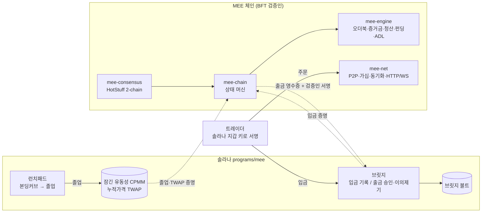

# MEE 아키텍처

목표는 **하이퍼리퀴드급(CEX급) perp 거래소를 솔라나 생태계에** 만드는 것이다.
구조는 하이퍼리퀴드와 같다. **매칭 엔진이 곧 BFT 체인**이고, 자금은 솔라나 브릿지에 있다.

그 위에 HIP-3보다 솔라나에 맞는 상장 경로를 얹었다. **런치패드 → 본딩커브 → 잠긴 유동성 AMM → 검증인이 증명한 TWAP → 자동 perp 상장.**
솔라나에서 막 태어난 토큰이 졸업하는 순간 레버리지 시장이 열리고, 토큰 제작자가 그 perp 수수료를 받는다.



## 1. 크레이트 구성

| 크레이트 | 역할 |
|---|---|
| `crates/mee-core` | 공용 수학, 파라미터, 에러 코드. **온체인 버전** 엔진 (고정 크기 `Pod`) |
| `crates/mee-engine` | **CEX급 엔진 v2.** 가격 레벨 오더북, 무제한 계정, 여러 DEX, 원자적 연산, 상태 커밋먼트 |
| `crates/mee-chain` | **체인 상태 머신.** 서명 트랜잭션, 블록 순서, 브릿지, 런치패드 상장/오라클, 스테이킹과 에폭, 거버넌스 |
| `crates/mee-consensus` | **BFT 합의** (sans-IO), 리더 평판, 커밋 증명 + 결정적 네트워크 시뮬레이터 |
| `crates/mee-node` | 합의 → 체인. 에폭 전환, 디스크 영속성, 검증된 상태 동기화 |
| `crates/mee-net` | **실제 네트워크.** 인증 TCP, 트랜잭션 가십, 동기화, HTTP/JSON + WebSocket API, `mee-validator` 바이너리 |
| `programs/mee` | **솔라나 프로그램.** 브릿지 + 런치패드 + 온체인 HIP-3 DEX(옵션 C) |

## 2. 측정값

4코어 클라우드 컨테이너, `--release`.

| 항목 | 값 | 재는 법 |
|---|---|---|
| 엔진 단일 스레드 (오더북 다이제스트 포함) | **약 173만 ops/s** | `cargo bench -p mee-engine` |
| 체인 전체 (서명 검증 + 논스 + 매칭 + 상태 루트) | **약 12.3만 tx/s** (4코어) | `cargo bench -p mee-chain` |
| 합의 (시뮬레이터, 링크 5~50ms) | 초당 약 20블록 확정. 4노드 중 1개 크래시: 평판 덕에 정상의 약 60% | `cargo test -p mee-consensus --release -- --nocapture` |
| 실제 TCP, 로컬 4프로세스 (빈 블록, fsync 포함) | 초당 약 200블록 | `mee-validator` 4개 실행 |

병목은 실행 쪽, 그중에서도 ed25519 서명 검증이다. 서명 검증은 코어 수에 비례해서 늘어난다.

## 3. 런치패드 → perp (솔라나 네이티브 상장)

HIP-3는 "스테이크를 건 배포자가 시장을 연다"이다. 여기선 그것 말고 **시장이 스스로 상장 자격을 증명**하는 경로를 하나 더 둔다.

```
CreateLaunch ─▶ 본딩커브 매매 ─▶ 커브 물량 매진 ─▶ Graduate ─▶ CPMM 풀 (LP 토큰 없음, 영구 잠금)
                (가상 CPMM)                                    │
                                                               ├─ PoolSwap마다 누적가격 갱신
                                                               ▼
                      검증인 정족수가 졸업 + TWAP + 풀 깊이를 서명 ─▶ ListLaunch (체인)
                      이후 주기적으로 LaunchOracle 배치 ─▶ 오라클 가격, OI 한도 갱신
```

**솔라나 쪽 (`programs/mee/src/launchpad.rs`)**
- `CreateLaunch`: 고정 공급량을 볼트에 민팅하고, 가상 유동성 `virtual_quote · virtual_tokens = k` 커브를 연다. 민트 권한은 프로그램 PDA라서 추가 발행이 불가능하다.
- `LaunchBuy` / `LaunchSell`: 커브와 거래. 프로토콜 수수료와 제작자 수수료가 붙고, 슬리피지 한도(`min_tokens_out` / `min_quote_out`)를 받는다. 반올림은 항상 커브에 유리한 쪽이다.
- `Graduate`: 커브 물량(`curve_supply`)이 다 팔리면 누구나 호출할 수 있다. 모은 quote + 남은 토큰으로 **커브 마지막 가격 그대로** CPMM 풀을 만든다. LP 토큰이 없어서 유동성을 빼갈 수 없다(러그 불가). 풀 수수료는 풀에 남아 깊이를 키운다.
- `PoolSwap`: 졸업 후 거래. 스왑마다 `cumulative_price += 가격 × 경과 초`를 갱신해서 Uniswap v2식 TWAP를 만든다.
- `ClaimCreatorFees`: 제작자가 커브 수수료를 찾아간다.

**체인 쪽 (`mee-chain`)**
- `ListLaunch` (검증인 정족수 서명): 프로토콜이 운영하는 `launchpad` DEX에 perp를 자동 상장한다.
  - **랏 크기**는 `lot_for(twap)`로 정한다. 랏 하나의 가치가 `min_lot_value` 이상이 되는 가장 작은 10의 거듭제곱이라서, 가격이 아주 낮은 밈코인도 정수 틱으로 거래된다.
  - **OI 한도**는 풀 quote 깊이 × `oi_cap_ratio_bps`. 얕은 풀로 큰 perp를 만들어서 오라클을 조작하는 걸 막는다.
  - **제작자 수수료:** 시장마다 `creator_fee_share_bps`. HIP-3 배포자 몫 대신 토큰 제작자 잔고로 바로 들어간다.
  - 증거금은 보수적인 기본값을 쓴다 (IM 20%, MM 10%).
- `LaunchOracle` (정족수 서명, 솔라나 슬롯이 단조 증가해야 함): 여러 토큰의 TWAP과 풀 깊이를 한 번에 반영한다. 밈코인은 빨리 움직이니까 한 번에 `max_oracle_move_bps`씩 **따라가고**, 거부하지는 않는다. OI 한도도 같이 갱신한다.
- 상장된 시장도 일반 시장과 똑같이 마크 가격, 펀딩 TWAP, 청산, ADL을 쓴다.

**왜 HIP-3보다 낫나:** 배포자 한 명의 키(오라클)를 믿는 대신, **잠긴 유동성 풀의 TWAP**과 **검증인 정족수**를 믿는다. 상장은 커브 졸업이라는 시장 신호로 무허가로 일어나고, 제작자는 퍼프 수수료라는 지속 수익을 얻는다.

E2E 테스트(`programs/mee/tests/launch_to_perp.rs`): 솔라나에서 런치 → 커브 매수 → 졸업 → 풀 스왑 → 검증인이 TWAP 서명 → 체인에서 perp 상장 → 거래 → 제작자 수수료 확인.

## 4. 엔진 v2 (`mee-engine`)

- **오더북:** 가격 레벨 `BTreeMap` + slab 안의 FIFO 연결 리스트. 주문 ID → slab 인덱스 맵으로 **취소 O(1)**.
- **원자성:** 주문은 체결, 수수료, OI, 테이커 증거금을 전부 시뮬레이션한 다음 적용한다(2패스). 실패한 연산은 상태를 전혀 바꾸지 않는다.
- **결정성:** 해시맵은 조회에만 쓰고 순회하지 않는다.
- **DEX 격리:** 계정마다 DEX별 마진. 자유 잔고 ↔ DEX 마진은 이체.
- **펀딩:** 매 블록 프리미엄을 샘플링해서 **TWAP**으로 쌓고, 주기마다 반영한다(lazy funding).
- **청산:** 청산자가 마크 가격에 인수(backstop). 보험기금이 부족하면 **ADL**: 반대편 포지션을 파산 가격에 강제로 줄인다. 손실 분담(socialization)은 정산(halt) 때만 쓴다.
- **상태 커밋먼트:** 계정은 증분 머클 트리(변경된 계정만 다시 해싱), 오더북은 주문마다 SHA-256 압축 1회짜리 가산 멀티셋 해시. 상태 루트 = H(계정 루트, 시장, DEX, 글로벌).

## 5. 체인 상태 머신 (`mee-chain`)

**트랜잭션**
- 사용자: `SignedTx { signer, nonce, action, signature }`, 메시지는 `sha256("MEE/tx" ‖ chain_id ‖ borsh(signer, nonce, action))`. 키가 그냥 ed25519라서 **솔라나 지갑 키로 바로 서명**한다.
- 논스는 계정 상태 안에 있어서 상태 루트에 포함된다. 서명과 논스가 맞으면 액션이 실패해도 논스는 소모된다.
- 시스템 트랜잭션(검증인 `⌊2n/3⌋+1` 서명): `BridgeDeposit`(입금 ID 순서대로), `Governance`(거버넌스 논스), `ListLaunch`, `LaunchOracle`.

**블록 실행**
1. 서명을 멀티코어 배치 검증
2. `begin_block`: 펀딩 샘플링/반영
3. 순서: **시스템 → 취소 → PostOnly → 나머지** (하이퍼리퀴드와 같은 메이커 보호)
4. 상태 루트를 커밋하고, app hash = H(이전 app hash, 블록, 결과, 이벤트, 출금, 상태 루트, 글로벌)

**계정 증명:** `prove_account` → `AccountProof`, `verify_account_proof(state_root, proof)`. 검증인은 `state_root_message(chain_id, height, root)`에 서명하므로, 라이트 클라이언트는 서명된 루트 하나로 잔고와 포지션을 확인할 수 있다.

**스테이킹과 에폭**
- `Delegate` / `Undelegate` (언본딩 기간 후 반환). 검증인 후보별 위임 합계가 스테이크다.
- `epoch_blocks`마다 상위 `max_validators`명(최소 스테이크 이상)을 선출한다. 집합이 바뀌면 `BlockOutcome.validator_set`에 실리고, 노드는 그 블록 직후 새 합의 인스턴스로 넘어간다. 브릿지는 같은 바이트(`valset_message`)로 `RotateValidators`를 한다.

## 6. 합의 (`mee-consensus`)

HotStuff 계열 **2-chain 커밋** (Jolteon / DiemBFT v4), sans-IO.

| 규칙 | 내용 |
|---|---|
| 리더 | **평판 기반.** 최근 커밋 10개(3라운드 지연)에 제안자나 투표자로 참여한 노드만 돌아가며 리더가 된다. 죽은 노드는 빠진다. 참여자가 정족수 미만이면 라운드로빈 |
| 투표 | 라운드당 한 번. r−1 QC를 잇거나, r−1 TC를 잇고 그 TC의 최고 QC 이상일 때만 |
| 커밋 | 블록 B의 바로 다음 라운드 자식이 인증되면 B 확정 |
| 페이스메이커 | 타임아웃이면 최고 QC 브로드캐스트, 2f+1이면 TC, f+1을 보면 따라서 타임아웃. 지수 백오프 |
| 블록 동기화 | 부모를 몰라도 저장하고 투표. 커밋할 때 빠진 조상을 요청하고 매 tick 재시도 |
| 영속성 | `SafetyState { round, last_voted_round, high_qc, voted }`를 **투표 전에** 원자적으로 저장(임시 파일 → fsync → rename → 디렉터리 fsync). `voted`는 아직 커밋 안 된, 내가 투표한 블록들이다 |
| 커밋 증명 | 커밋을 만든 QC와 그 블록(`commit_witness`), 또는 연속 라운드의 자식 두 개. `verify_committed_segment`로 검증인 서명만으로 확인 |

**`voted`가 왜 필요한가:** 제안은 블록 본문 없이 QC만으로 이어갈 수 있다. 그래서 네트워크 전체가 동시에 재시작하면, 인증됐지만 커밋 안 된 블록을 아무도 디스크에 갖고 있지 않아서 커밋이 영원히 멈췄다(실제 4프로세스 재시작에서 발견). 투표 전에 블록을 저장하면 인증된 블록은 항상 정직한 노드 f+1명 이상의 디스크에 남는다. `whole_network_restart_resumes_from_disk` 테스트가 이 경우를 다룬다(수정 전엔 실패).

## 7. 노드와 네트워크 (`mee-node`, `mee-net`)

**노드**
- 커밋된 블록은 길이 접두 로그(`blocks.log`)에 fsync해서 추가한다. 끝이 잘린 레코드(쓰는 중 크래시)는 열 때 잘라낸다.
- 재시작하면 로그를 재생해서 체인 상태를 다시 만들고(에폭 전환도 똑같이), 현재 에폭의 합의를 저장된 안전 상태로 복원한다.
- **검증된 상태 동기화:** `serve_sync`는 한 에폭 안의 커밋된 블록 구간(최대 256블록 / 16MiB)과 커밋 증명을 준다. 받는 쪽은 자기가 아는 검증인 집합으로 서명만 확인하면 되므로 **아무 피어에게서나** 받을 수 있다. 에폭 경계를 넘으면 다음 에폭으로 넘어가서 계속한다.

**네트워크 (`mee-net`)**
- **전송:** TCP, `u32 길이 + borsh` 프레임(최대 64MiB). 연결마다 **상호 핸드셰이크**: 양쪽이 상대가 보낸 새 nonce에 자기 검증인 키로 서명한다. 합의 메시지는 인증된 키와 `Envelope.from`이 같을 때만 받는다.
- **피어:** 설정된 주소를 계속 다이얼하고(지수 백오프 재접속), 들어오는 연결도 받는다. 피어별 쓰기 큐는 크기 제한이 있고, 넘치면 버린다(합의는 손실을 견딘다).
- **가십:** 멤풀이 해시로 중복을 걸러서, 새로 들어온 트랜잭션만 출처를 뺀 모든 피어에게 전달한다.
- **동기화:** 노드는 1초마다 `Status { epoch, height }`를 알린다. 피어보다 `SYNC_LAG`(8)블록 이상 또는 에폭이 뒤처지면 동기화 구간을 요청한다.
- **API (HTTP/JSON, WebSocket):**

| 경로 | 내용 |
|---|---|
| `POST /tx` | `{"tx": "<hex borsh Tx>"}` → 멤풀 + 가십 |
| `GET /status` | 높이, 에폭, app hash, 상태 루트, 검증인, 피어 |
| `GET /book/{market}?depth=N` | 호가, 오라클, OI |
| `GET /account/{pubkey}` | 잔고, 마진, 포지션, 논스 + **머클 증명** |
| `GET /withdrawals/{id}` | 출금 영수증 + 이 검증인의 브릿지 메시지 서명 (릴레이어가 정족수만큼 모음) |
| `GET /state_root/{height}` | 상태 루트 + 이 검증인의 서명 |
| `GET /ws` | 커밋된 블록마다 이벤트(체결, 청산, 펀딩, ADL...), 출금, 루트 |

로컬 devnet 실행:
```bash
cargo build --release -p mee-net
for i in 0 1 2 3; do ./target/release/mee-validator --index $i --data ./data & done
curl localhost:8600/status
```

## 8. 솔라나 브릿지 (`programs/mee/src/bridge.rs`)

| 명령 | 내용 |
|---|---|
| `InitBridge` | 브릿지 PDA(검증인 최대 16명), 볼트, 이의제기 기간 |
| `BridgeDeposit` | 토큰을 볼트에 잠그고 순번이 붙은 `DepositRecord` 생성 |
| `RequestWithdrawal` | 체인 영수증으로 `WithdrawalRecord` 생성 (영수증 ID당 하나) |
| `ApproveWithdrawal` | 같은 트랜잭션의 **Ed25519 precompile**이 검증한 서명을 instructions sysvar로 읽어서 승인 비트맵에 추가. **여러 트랜잭션에 나눠서** 할 수 있으므로 검증인 수가 트랜잭션 크기에 묶이지 않는다. 정족수에 닿은 시각을 기록 |
| `FinalizeWithdrawal` | 정족수 + 이의제기 기간이 지나면 지급. 받는 토큰 계정의 owner가 영수증 destination이어야 함 |
| `LockBridge` | **검증인 한 명**이 사기를 보면 지급을 멈춘다 |
| `UnlockBridge` / `CancelWithdrawal` | 정족수 서명 (lock nonce로 재사용 방지) |
| `RotateValidators` | 현재 정족수가 `valset_message`에 서명. 교체하면 이전 집합의 승인은 무효 |

메시지 바이트가 체인 쪽(`mee-chain::crypto`)과 같은지는 테스트로 직접 비교한다. 솔라나 시계/렌트는 sysvar 계정으로 받는다.

## 9. 회계 모델

```
매수 q @ p:  base += q, quote −= q·p      (매도는 반대)
미실현 PnL = base·mark + quote,  base = 0이 되면 quote → 담보
mark = clamp(median(oracle, best_bid, best_ask), oracle ± mark_band)
equity      = 담보 + Σ(base·mark + quote − 미정산 펀딩)
initial     = Σ max(|base + 미체결 매수|, |base − 미체결 매도|) · mark · IM%
maintenance = Σ |base| · mark · MM%
```
- 시장마다 Σbase = 0, Σquote = 0. 반올림은 항상 트레이더에게 불리한 쪽이다.
- 부실채권: 보험기금 → ADL(파산 가격) → 정산 시에만 분담 → 남으면 `unrecovered_loss`.
- 불변식 `들어온 돈 − 나간 돈 + unrecovered ≥ 모든 청구액`을 랜덤 테스트가 매 단계 검사한다.

## 10. 체인 안의 HIP-3

| HIP-3 | MEE |
|---|---|
| 배포자 스테이크, 최소 유지, 언스테이크 대기 | `DeployDex`, `min_stake_hold_secs`, `unstake_delay_secs` |
| 검증인 투표 슬래싱 | `Governance::Slash` (정족수), 선택적 동결 |
| 배포자 오라클 | `SetOracle`, 변동폭/빈도 제한 |
| 배포자 수수료 0~300% | `fee_share_bps` |
| 시장 중단 → 정산 | `HaltMarket` → 즉시 전원 정산 |
| DEX별 격리 | DEX별 마진, 보험기금 |

런치패드 시장은 이 위에 프로토콜 DEX(`attested_oracle`)로 올라간다. 오라클 권한이 배포자 키가 아니라 검증인 정족수다.

## 11. 테스트

```bash
cargo test --workspace
cargo test -p mee-consensus --release   # 합의 시뮬레이션
cargo bench -p mee-engine && cargo bench -p mee-chain
```

| 크레이트 | 테스트 |
|---|---|
| mee-core | 단위 10 + 시나리오/랜덤 18 |
| mee-engine | 단위 3 + 13 (ADL, 펀딩 TWAP, 제작자 수수료, 랜덤 원자성/불변식) |
| mee-chain | 단위 2 + 9 (계정 증명, 스테이킹/에폭, 런치 상장/오라클 포함) |
| mee-consensus | 시뮬레이션 10 (장애 스윕, 평판, 재시작 후 이중 투표 금지) |
| mee-node | 단위 1 + devnet 6 (크래시, 디스크 재시작, **전체 재시작**, 스테이크로 검증인 교체, 늦게 합류한 노드의 검증된 동기화) |
| mee-net | 단위 3 (핸드셰이크 위조/다른 체인 거부, 프레임) + **실제 TCP 4검증인 클러스터** (서로 다른 노드로 HTTP 제출 → 가십 → 체결을 WebSocket으로 수신, 머클 증명 검증, 서명된 상태 루트 일치, 늦은 옵저버 동기화) |
| programs/mee | 단위 3 + 11 (온체인 DEX 4, 브릿지 4, 런치패드 2, 런치 → perp E2E 1) |

## 12. 한계와 다음 단계

- **SBF 빌드와 CU 측정 미완:** 솔라나 platform-tools를 이 환경에서 받아 실행하는 게 막혀 있다. 프로그램 테스트는 네이티브(`solana-program-test`)로 돈다. `cargo build-sbf` 후 CU를 재야 한다.
- **P2P 암호화 없음:** 핸드셰이크는 신원을 인증하지만 이후 트래픽은 평문이다(합의 메시지는 자체 서명됨). Noise/QUIC로 바꿔야 한다. 지금은 풀 메시 전제라 대규모 옵저버 네트워크용 가십 토폴로지는 없다.
- **스냅샷 없음:** 재시작과 신규 노드는 블록 로그 전체를 재생/동기화한다. 상태 스냅샷 + 머클 증명 기반 빠른 동기화가 필요하다. 빈 블록도 계속 만들어서 로그가 쌓인다.
- **브릿지 서명 집계:** 승인은 여러 트랜잭션으로 나눌 수 있지만 서명은 개별 ed25519다. BLS/ZK 집계가 있으면 더 싸다.
- **런치패드 TWAP 소스:** 검증인이 풀 누적가격을 읽는 부분(오프체인 관찰자)은 테스트 하네스가 대신한다. 노드 안의 솔라나 RPC 관찰자가 필요하다.
- **보안 감사 전이다.** 실자금에 쓰면 안 된다.
