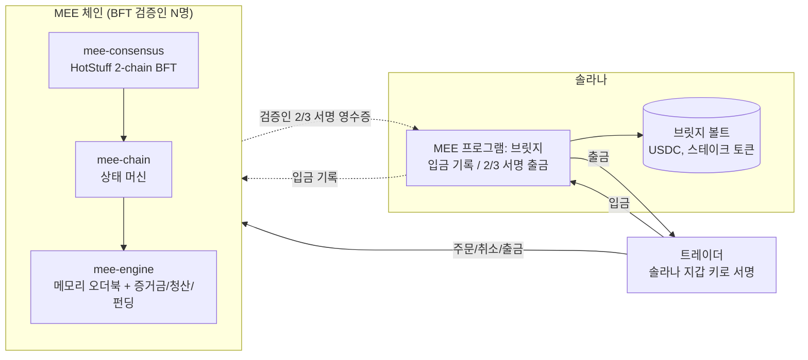

# MEE 아키텍처

목표는 **하이퍼리퀴드급(CEX급) perp 거래소를 솔라나 생태계에** 만드는 것이다.
구조는 하이퍼리퀴드와 같다. **매칭 엔진이 곧 체인**이고, 자금은 솔라나에 있다.



## 1. 크레이트 구성

| 크레이트 | 역할 |
|---|---|
| `crates/mee-core` | 공용 수학, 파라미터, 에러 코드. 그리고 **온체인 버전** 엔진 (고정 크기 `Pod`, 솔라나 계정에 바로 매핑) |
| `crates/mee-engine` | **CEX급 엔진 v2.** 가격 레벨 오더북, 무제한 계정, 여러 HIP-3 DEX, 원자적 연산 |
| `crates/mee-chain` | **체인 상태 머신.** 서명된 트랜잭션, 논스, 블록 순서 규칙, 브릿지 입출금, 거버넌스(슬래싱), app hash |
| `crates/mee-consensus` | **BFT 합의** (sans-IO) + 결정적 네트워크 시뮬레이터 |
| `crates/mee-node` | 합의 → 체인을 잇는 검증인 노드. 4노드 devnet 테스트 |
| `programs/mee` | **솔라나 프로그램.** 브릿지(입금, 2/3 서명 출금, 검증인 교체) + 온체인 HIP-3 DEX 명령(옵션 C) |

## 2. 측정값

4코어 클라우드 컨테이너에서 `--release`로 잰 값이다. 실제 검증인 서버(16~32코어)에선 서명 검증 쪽이 코어 수에 비례해 올라간다.

| 항목 | 값 | 재는 법 |
|---|---|---|
| 엔진 단일 스레드 | **약 229만 ops/s** (438ns/op), 미체결 주문 약 31.6만 개 | `cargo bench -p mee-engine` |
| 체인 전체 (서명 검증 + 논스 + 매칭 + app hash) | **약 14만 tx/s** (4코어), 서명 검증 단독은 약 16만/s | `cargo bench -p mee-chain` |
| 합의 | 4노드, 링크 지연 5~50ms에서 **초당 약 20블록 확정** (블록당 트랜잭션 수와 무관) | `cargo test -p mee-consensus --release -- --nocapture` |

참고로 하이퍼리퀴드는 공식 문서 기준으로 초당 약 20만 주문, 지연 중간값 약 0.2초이고, 병목은 실행 쪽이라고 한다.
MEE도 병목은 실행이다. 그중에서도 ed25519 서명 검증이 대부분이고, 매칭 엔진 자체는 그보다 10배 이상 빠르다.

## 3. 엔진 v2 (`mee-engine`)

- **오더북:** 가격 레벨을 `BTreeMap`으로 두고, 각 레벨은 slab 안의 FIFO 연결 리스트다. 주문 ID → slab 인덱스 맵으로 **취소가 O(1)**. 빈 슬롯은 재사용한다.
- **원자성:** 실패한 연산은 상태를 전혀 바꾸지 않는다. 그래서 블록을 트랜잭션 단위로 적용할 때 스냅샷이 필요 없다.
  - 주문은 체결, 수수료, OI, 테이커 증거금을 **전부 시뮬레이션한 다음** 적용한다.
  - 청산은 관련 마진 몇 개만 스냅샷했다가, 청산자 증거금이 부족하면 복원한다.
- **결정성:** 해시맵은 조회에만 쓰고 순회하지 않는다. 순회가 필요한 건 전부 Vec이나 BTreeMap(가입 순서, 가격 순서)이다.
- **HIP-3 DEX 격리:** 계정마다 DEX별 마진(담보 + 포지션)을 따로 둔다. 자유 잔고 ↔ DEX 마진은 이체로 옮긴다.
- **펀딩:** 블록 시작(`begin_block`) 때 기한이 된 시장마다 자동 반영된다. 크랭크 트랜잭션이 필요 없다.
- **회계 모델:** 온체인 버전과 같다 (9절).

## 4. 체인 상태 머신 (`mee-chain`)

### 트랜잭션
- **사용자 트랜잭션:** `SignedTx { signer, nonce, action, signature }`
  - 서명 메시지는 `sha256("MEE/tx" ‖ chain_id ‖ borsh(signer, nonce, action))`
  - 키가 그냥 ed25519라서 **솔라나 지갑 키로 바로 서명**된다 (E2E 테스트에서 같은 키로 확인함)
- **논스:** 계정별로 엄격히 증가해야 한다. 서명과 논스가 유효하면 **액션이 실패해도 논스는 소모**돼서 재전송(replay)이 불가능하다.
- **시스템 트랜잭션:** 검증인 정족수 서명이 필요하다.
  - `BridgeDeposit`: 솔라나 입금 기록에 대한 증명. 입금 ID가 **순서대로** 와야 함
  - `Governance`: 슬래싱, 동결된 DEX 시장 중단. 거버넌스 논스로 재사용 방지
- **정족수:** 검증인 수가 n이면 `⌊2n/3⌋ + 1` (n = 3f + 1 기준 2f + 1)

### 블록 실행
1. 모든 트랜잭션 서명을 **멀티코어로 배치 검증** (ed25519 batch, 실패하면 개별 검증으로 범인 찾기)
2. `begin_block(now)`: 펀딩
3. 순서: **시스템 → 취소 → PostOnly 주문 → 나머지.** 같은 등급 안에선 제안자 순서를 유지한다. 하이퍼리퀴드와 같은 규칙인데, 메이커가 낡은 호가를 저격당하지 않게 보호해준다.
4. app hash = 이전 hash + 블록 + 결과 + 이벤트 + 출금 영수증의 해시 체인

### 출금
`Withdraw` 액션은 잔고를 깎고 `WithdrawalReceipt { id, asset, destination, amount }`를 만든다.
검증인이 `sha256("MEE/withdraw" ‖ chain_id ‖ id ‖ asset ‖ destination ‖ amount)`에 서명하면, 솔라나 브릿지가 정족수를 확인하고 지급한다.

## 5. 합의 (`mee-consensus`)

HotStuff 계열 **2-chain 커밋** (Jolteon / DiemBFT v4 방식)이고, sans-IO라서 네트워크 코드와 분리돼 있다.

| 규칙 | 내용 |
|---|---|
| 리더 | 라운드 r의 리더 = `r mod n` |
| 제안 | 리더가 아는 가장 높은 QC를 넣어서 블록 제안. 직전 라운드가 타임아웃이었으면 TC도 첨부 |
| 투표 규칙 | 라운드당 한 번, 현재 라운드에만. 블록이 r−1 QC를 잇거나, r−1 TC를 잇고 그 TC의 최고 QC 이상일 때만 |
| QC | 다음 리더가 2f+1 표를 모으면 QC. QC를 보면 모두 다음 라운드로 |
| 커밋 규칙 | 블록 B의 **바로 다음 라운드** 자식이 인증되면 B 확정 |
| 페이스메이커 | 타임아웃이 나면 그 라운드 투표를 멈추고 최고 QC를 브로드캐스트. 2f+1이면 TC. f+1 타임아웃을 보면 따라서 타임아웃(느린 타이머가 발목 잡지 않게). 연속 타임아웃마다 지수 백오프 |
| 블록 동기화 | 부모를 몰라도 블록은 저장하고 투표. 커밋할 때 빠진 조상을 요청하고, 매 tick 재시도 |

**시뮬레이터 테스트:** 시드 고정이라 결정적이다.
- 정상, 아무 노드 1개 크래시, 7노드에서 메시지 10% 손실, 네트워크 분할 후 회복, 리더 이중 제안(equivocation)
- f를 넘는 크래시: **포크 대신 멈추는지** 확인
- 40가지 장애 조합 랜덤 스윕: **어떤 두 노드도 서로 다른 블록을 확정하지 않는지** 확인

## 6. 솔라나 브릿지 (`programs/mee`의 `bridge`)

| 명령 | 내용 |
|---|---|
| `InitBridge` | 브릿지 PDA (검증인 최대 16명, 정족수는 체인과 같은 규칙), USDC/스테이크 볼트 (PDA 소유) |
| `BridgeDeposit` | 토큰을 볼트에 잠그고 순번이 붙은 `DepositRecord` PDA 생성. 검증인은 이걸 읽어서 순서대로 증명 |
| `BridgeWithdraw` | 같은 트랜잭션 안의 **Ed25519 precompile**이 검증한 서명을 instructions sysvar로 읽어서 정족수 확인. offset이 전부 precompile 명령 자신을 가리키는 항목만 인정해서, 우리가 읽는 값 = 실제 검증된 값이 되게 함. `WithdrawalRecord` PDA로 영수증당 1회 지급. 받는 토큰 계정의 owner가 영수증의 destination이어야 함 |
| `RotateValidators` | 현재 검증인 정족수가 `sha256("MEE/valset" ‖ chain_id ‖ nonce ‖ 새 목록)`에 서명해야 교체 |

메시지 바이트가 체인 쪽(`mee-chain::crypto`)과 프로그램 쪽에서 똑같은지는 테스트로 직접 비교한다.

## 7. 체인 안의 HIP-3

| HIP-3 (하이퍼리퀴드) | MEE 체인 |
|---|---|
| 배포자 HYPE 스테이크 | 솔라나에서 브릿지한 스테이크 토큰으로 `DeployDex` (`min_deployer_stake` 이상) |
| 최소 유지, 언스테이크 대기 | `min_stake_hold_secs`, `unstake_delay_secs` (대기 중에도 슬래싱 가능) |
| 검증인 투표 슬래싱 | `Governance::Slash`: 검증인 정족수 서명, 선택적으로 동결 |
| 배포자 오라클 | `SetOracle`: DEX의 oracle authority만 가능. 1회 변동폭과 빈도 제한 |
| 배포자 수수료 0~300% | `fee_share_bps`, 기본 수수료 위에 추가 |
| 시장 중단 → 정산 | `HaltMarket` → 즉시 전원 정산 (체인 안이라 페이지 나눌 필요 없음) |
| DEX별 격리 | DEX별 마진, 보험기금, 부실채권 분담 |

## 8. 결정성과 합의 안전성 요약

- 엔진과 체인은 같은 블록을 넣으면 같은 app hash가 나온다. devnet 테스트가 4노드에서 **모든 높이**를 비교한다.
- 서명 검증만 병렬이고 순수 함수라서 결정성에 영향이 없다.
- 노드는 커밋 순번을 블록 높이로 쓰고, 타임스탬프는 단조 증가하게 고정한다. 그래서 정직한 노드는 똑같은 체인 블록을 만든다.

## 9. 회계 모델 (온체인, v2 공통)

```
매수 q @ p:  base += q, quote −= q·p      (매도는 반대)
미실현 PnL = base·mark + quote,  base = 0이 되면 quote → 담보
mark = clamp(median(oracle, best_bid, best_ask), oracle ± mark_band)
equity      = 담보 + Σ(base·mark + quote − 미정산 펀딩)
initial     = Σ max(|base + 미체결 매수|, |base − 미체결 매도|) · mark · IM%
maintenance = Σ |base| · mark · MM%
```
- 시장마다 Σbase = 0, Σquote = 0. 펀딩 반올림은 항상 트레이더에게 불리한 쪽이라 남는 건 볼트에 쌓인다.
- **청산:** 청산자가 마크 가격에 포지션을 인수 (backstop). 페널티는 남은 equity를 넘지 않음. 일부는 보험기금으로
- **부실채권:** 보험기금 → 같은 DEX 회원의 양수 담보에서 비율대로 분담 → 그래도 남으면 `unrecovered_loss`
- **불변식:** `들어온 돈 − 나간 돈 + unrecovered ≥ 모든 청구액`. 랜덤 테스트가 매 단계 검사한다.

## 10. 온체인 버전 (옵션 C)

`mee-core` + `programs/mee`의 DEX 명령들은 **완전히 솔라나 위에서** 돌아가는 HIP-3 DEX다.
DEX당 쓰기 잠금 계정 하나에 막혀서 CEX급은 못 되지만, 거래량 적은 시장이나 레퍼런스 구현으로 남겨뒀다.
배포자 스테이크, 가디언 슬래싱, 동결, 시장 중단, 페이지 단위 정산이 다 들어 있다.

## 11. 테스트

```bash
cargo test --workspace                 # 전부
cargo test -p mee-consensus --release  # 합의 시뮬레이션 (빠르게)
cargo bench -p mee-engine              # 엔진 처리량
cargo bench -p mee-chain               # 체인 처리량
```

| 크레이트 | 테스트 |
|---|---|
| mee-core | 단위 10 + 시나리오 17 + 랜덤 불변식 (36k 액션) |
| mee-engine | 단위 1 + 시나리오 10 + 랜덤 원자성/불변식 (32k 액션, 거부된 액션이 상태를 안 바꿨는지 지문 비교) |
| mee-chain | 단위 2 + 7 (서명/논스/재전송, 입금 정족수와 순서, 출금 영수증, 취소 우선 순서, 레플리카 일치, 거버넌스, 배치 서명 위조 탐지) |
| mee-consensus | 시뮬레이션 8 (위 5절) |
| mee-node | devnet 2 (4노드 전원 정상 / 1노드 크래시, 모든 높이에서 app hash 일치) |
| programs/mee | 온체인 DEX E2E 4 + 브릿지 E2E 3 (솔라나 입금 → 체인 반영 → 체인 출금 → 2/3 서명 → 솔라나 지급, 정족수 미달/외부인/위조 서명/재전송/엉뚱한 수령인/검증인 교체) |

## 12. 한계와 다음 단계

**합의, 노드**
- **리더 평판 없음:** 라운드로빈이라 죽은 노드가 리더가 되거나 그 노드에 투표를 보내는 라운드는 타임아웃이 난다. 4노드 중 1개가 죽으면 블록 속도가 크게 떨어진다 (devnet 테스트에서 확인). DiemBFT식 leader reputation이 필요하다.
- **영속성 없음:** `last_voted_round`를 디스크에 안 쓴다. 재시작한 노드가 같은 라운드에 다시 투표하면 안전성이 깨질 수 있다. WAL과 스냅샷이 필요하다.
- **실제 네트워크 계층 없음:** P2P(QUIC/TCP), 멤풀 가십, 상태 동기화는 아직 없다. 지금은 테스트 하네스가 메시지를 직접 배달한다.
- **API 없음:** WebSocket/REST가 없다.

**체인**
- **체인 쪽 검증인 교체 없음:** 브릿지엔 `RotateValidators`가 있는데, 체인 쪽엔 검증인 스테이킹과 집합 변경이 아직 없다.
- **app hash가 상태 머클 루트가 아님:** 결과와 이벤트의 해시 체인이다. 라이트 클라이언트가 상태를 증명하려면 머클화된 상태가 필요하다.
- **출금 이의제기 기간 없음:** 하이퍼리퀴드 브릿지엔 출금 후 분쟁 기간이 있는데, 아직 안 넣었다.

**브릿지**
- **트랜잭션 크기 제한:** Ed25519 서명 항목이 각각 약 110바이트라서, 솔라나 트랜잭션 하나(1232바이트)에 약 6~7개가 한계다. 검증인을 늘리려면 여러 precompile 명령이나 트랜잭션으로 나누거나, BLS/ZK 집계가 필요하다.

**엔진**
- 펀딩 프리미엄을 블록 시점에 한 번만 샘플링한다 → TWAP 필요
- ADL 없음

**공통**
- 솔라나 프로그램의 SBF 빌드와 CU 측정을 아직 못 했다 (이 환경에 플랫폼 툴이 없음)
- **보안 감사 전이다.** 실자금에 쓰면 안 된다.
