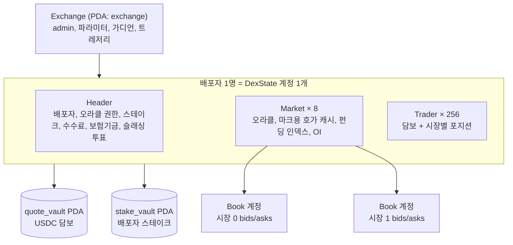
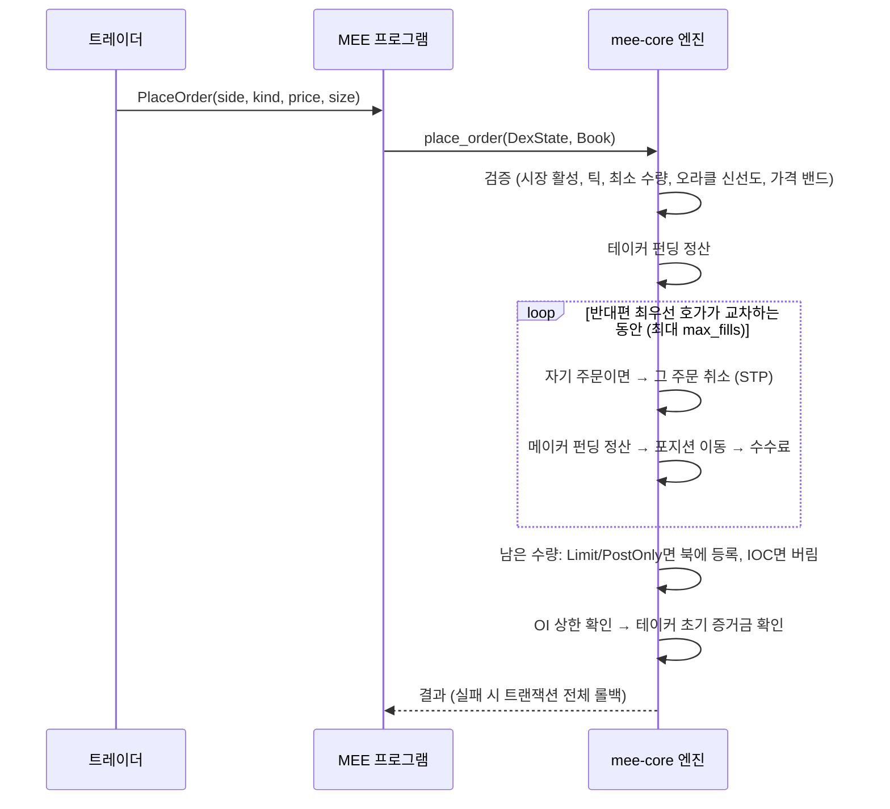
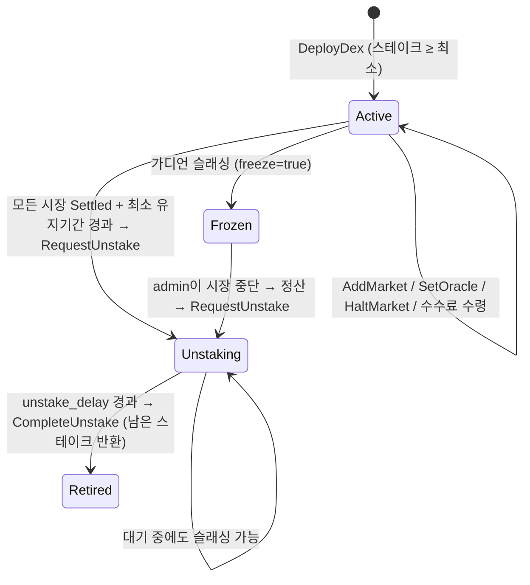

# MEE 아키텍처

솔라나 위에서 **HIP-3처럼 누구나 스테이크를 걸고 자기 perp DEX를 여는** 구조다.
오더북, 매칭, 증거금, 청산, 펀딩, 정산이 전부 **프로그램 하나 안에** 들어 있다. Percolator 같은 외부 perp 인프라는 쓰지 않는다.

## 1. 왜 "검증기"가 아니라 "프로그램"인가

| 선택지 | 의미 | 판단 |
|---|---|---|
| 검증기(validator) 자체에 엔진 넣기 | 솔라나를 포크해서 자체 체인(또는 SVM 롤업)을 운영 | 솔라나 메인넷 유동성, 지갑, 토큰(xStocks 등)을 그대로 못 씀. 운영 부담도 큼 |
| **온체인 프로그램에 엔진 넣기** | 솔라나 메인넷에 프로그램 하나 배포 | **채택.** 체결이 같은 트랜잭션 안에서 바로 정산됨 (crank 없음) |

다만 엔진은 `crates/mee-core`로 **솔라나 의존성 없이** 분리해 뒀다.
나중에 자체 SVM 롤업이나 앱체인으로 가고 싶으면, 같은 crate를 검증기 builtin으로 옮기면 된다.

## 2. HIP-3 ↔ MEE 대응표

| HIP-3 (Hyperliquid) | MEE (Solana) |
|---|---|
| 배포자가 HYPE 50만 개 스테이크 | 배포자가 `stake_mint` 토큰을 `min_deployer_stake` 이상 스테이크 (`DeployDex`) |
| 배포 후 최소 유지 기간 | `min_stake_hold_secs` (기본값 예: 183일) |
| 언스테이크 대기 중에도 슬래싱 가능 | `RequestUnstake` → `unstake_delay_secs` 동안 슬래싱 가능 → `CompleteUnstake` |
| 검증인 스테이크 가중 투표로 슬래싱 | **가디언 N명 중 threshold 이상 투표** (`VoteSlash` → `ExecuteSlash`) |
| 배포자가 오라클 가격 설정 | 배포자가 지정한 `oracle_authority`가 `SetOracle`로 푸시 (변동폭, 빈도 제한 있음) |
| 배포자 수수료 0~300% | `fee_share_bps` 0~`max_fee_share_bps`(30000). 기본 수수료 **위에 추가로** 부과되고 배포자가 가져감 |
| 배포자가 시장 중단 → 정산 | `HaltMarket`(정산 가격 지정) → `SettleMarket`(누구나 호출, 페이지 단위) |
| DEX별 증거금/리스크 격리 | DEX마다 별도 `DexState` 계정 + 별도 USDC 볼트. 한 DEX가 망가져도 다른 DEX에 안 번짐 |
| 시장별 OI 상한 | `oi_cap`. 넘으면 포지션 늘리는 주문은 거부, 줄이는 주문만 가능 |
| (없음) | 슬래싱 시 `freeze`면 DEX가 거버넌스로 넘어감: 배포자는 오라클, 시장 추가, 중단, 수수료 수령 불가 |

## 3. 계정 구조



| 계정 | 생성 | 크기 | 내용 |
|---|---|---|---|
| `Exchange` | 프로그램 (PDA `["exchange"]`) | 544 B | admin, quote/stake mint, 트레저리, `EngineParams`, 가디언 |
| `DexState` | 클라이언트가 만들고 `DeployDex`가 초기화 (DEX 계정이 서명해야 함) | ~145 KB | 헤더 + 시장 8개 + 트레이더 256명 |
| `Book` | 클라이언트가 만들고 `AddMarket`이 초기화 (book 계정이 서명해야 함) | ~10 KB | bids/asks 각 128개, 가격-시간 우선순위 |
| `quote_vault` | 프로그램 (PDA `["quote_vault", dex]`) | SPL 토큰 계정 | 모든 트레이더 담보 + 보험기금 + 미수령 수수료 |
| `stake_vault` | 프로그램 (PDA `["stake_vault", dex]`) | SPL 토큰 계정 | 배포자 스테이크 |
| `vault_authority` | PDA `["vault_authority", dex]` | 없음 | 두 볼트의 토큰 owner |

모든 상태는 `bytemuck` `Pod` 구조체(8바이트 정렬, 명시적 패딩)라서 **복사 없이 계정 데이터에 바로 매핑**된다.

## 4. 주문 처리 (한 트랜잭션 안에서 끝남)



- **주문 종류:** `Limit`(체결 후 나머지 등록), `PostOnly`(교차하면 거부), `ImmediateOrCancel`(나머지 버림)
- **reduce-only:** 포지션을 줄이는 방향만 가능하고 크기는 현재 포지션까지로 잘림. 북에 남지 않음. 증거금 체크도 없어서 청산 직전 계정도 포지션을 줄일 수 있다.
- **북이 가득 찼을 때:** 새 주문이 최악 주문보다 좋으면 최악 주문을 밀어내고 그 주문의 증거금을 풀어줌. 아니면 `BookFull`.

## 5. 회계 모델

### 포지션
가격 단위는 **베이스 랏당 quote 원자 단위**(USDC 6자리 기준)다.

```
매수 q @ p:  base += q,  quote -= q·p
매도 q @ p:  base -= q,  quote += q·p
미실현 PnL = base · mark + quote
base가 0이 되면 quote를 담보로 옮김 (실현)
```

평균 진입가를 따로 저장하지 않는다. 모든 체결이 양쪽에 정확히 반대로 기록되니까 **시장마다 Σbase = 0, Σquote = 0**이 항상 성립한다. 반올림으로 인한 오차가 생기지 않는다.

### 마크 가격
```
raw  = median(oracle, best_bid, best_ask)   (한쪽 호가가 비면 oracle)
mark = clamp(raw, oracle ± mark_band_bps)
```
얇은 호가로 마크를 끌고 가는 걸 막으려고 오라클 밴드 안으로 묶는다.

### 증거금 (DEX 안에서 교차 증거금)
```
equity      = 담보 + Σ(base·mark + quote − 미정산 펀딩)
initial     = Σ max(|base + 미체결 매수|, |base − 미체결 매도|) · mark · IM%
maintenance = Σ |base| · mark · MM%
```
- 새 주문과 출금은 `equity ≥ initial`을 만족해야 함 (미체결 주문이 전부 체결되는 최악의 경우 기준)
- `equity < maintenance`면 청산 가능

### 청산
1. 누구나 `Liquidate` 호출 가능 (청산자도 같은 DEX에 등록된 트레이더여야 함)
2. 피청산자의 해당 시장 주문 전부 취소
3. **청산자가 마크 가격에 포지션을 그대로 인수** (backstop 방식이라 호가가 비어 있어도 됨). `max_base`로 부분 청산 가능
4. 페널티 = 명목가 × `liquidation_fee_bps`. **피청산자에게 남은 equity를 넘지 않게** 캡을 씌움
5. 페널티 중 `liquidation_insurance_share_bps`만큼은 보험기금, 나머지는 청산자 몫
6. 청산자는 인수 후에도 초기 증거금을 만족해야 함

### 부실채권
트레이더가 모든 시장에서 포지션이 없는데 담보가 음수면:
1. 보험기금에서 먼저 메움
2. 모자라면 같은 DEX의 다른 트레이더 양수 담보에서 **비율대로 차감** (socialized loss)
3. 그래도 모자라면 `unrecovered_loss`에 기록 (DEX가 지급불능 상태라는 뜻)

### 펀딩
- 누구나 `UpdateFunding`을 호출할 수 있고, `funding_interval`마다 한 번만 반영됨
- `rate = clamp((mark − oracle) / oracle, ± max_funding_bps)`
- 누적 인덱스에 `oracle × rate`를 더하고, 각 포지션은 다음에 건드릴 때 지연 정산
- 반올림은 항상 **트레이더에게 불리한 쪽** → 남는 차액은 볼트에 쌓임 (볼트가 모자랄 일은 없음)

### 지급능력 불변식
```
vault 잔고 + unrecovered_loss ≥ Σ담보 + Σ(quote − 미정산 펀딩) + 보험기금 + 미수령 수수료
```
랜덤 테스트가 매 단계마다 이걸 검사한다.

## 6. 배포자 수명주기



시장 상태는 `Active → Halted(북 비움, 정산 가격 고정) → Settled(모든 포지션 정산 완료)` 순서로 간다.

## 7. 오라클 안전장치 (배포자 키가 털려도 피해를 제한)

- 한 번에 움직일 수 있는 폭: `max_oracle_move_bps`
- 업데이트 최소 간격: `min_oracle_interval`
- 오라클이 `max_oracle_staleness`보다 오래되면 → 포지션을 늘리는 주문, 청산, 펀딩, (노출 있는) 출금이 막힘. reduce-only와 취소는 가능
- 정산 가격도 오라클에서 한 스텝 이내여야 함
- 그래도 악용하면 가디언이 슬래싱하고 DEX를 동결

## 8. 파라미터 (`EngineParams`)

| 이름 | 의미 | 테스트에서 쓴 값 |
|---|---|---|
| `taker_fee_bps` / `maker_fee_bps` | 프로토콜 기본 수수료 | 5 / 1 |
| `max_fee_share_bps` | 배포자 추가 수수료 상한 | 30000 (300%) |
| `max_oracle_move_bps` | 오라클 1회 최대 변동 | 500 (5%) |
| `min_oracle_interval` | 오라클 업데이트 최소 간격(초) | 0 |
| `max_oracle_staleness` | 오라클 유효 시간(초) | 60 ~ 3600 |
| `mark_band_bps` | 마크 가격 밴드 | 100 (1%) |
| `order_band_bps` | 주문 가격 밴드 | 5000 (50%) |
| `max_fills_per_order` | 주문당 최대 체결 수 (CU 상한) | 16 ~ 32 |
| `liquidation_insurance_share_bps` | 페널티 중 보험기금 몫 | 5000 |
| `min_deployer_stake` | 최소 배포자 스테이크 | 500,000 |
| `min_stake_hold_secs` | 배포 후 최소 유지 | 1000 (실서비스는 183일 권장) |
| `unstake_delay_secs` | 언스테이크 대기 | 100 (실서비스는 7일 권장) |
| `min_initial_margin_bps` | 최대 레버리지 상한 | 500 (20배) |

시장별로는 `tick_size`, `min_base_lots`, `initial/maintenance_margin_bps`, `liquidation_fee_bps`, `oi_cap`, `funding_interval`, `max_funding_bps`를 따로 정한다.

## 9. 테스트

| 테스트 | 위치 | 내용 |
|---|---|---|
| 단위 테스트 10개 | `crates/mee-core/src/*` | 반올림, 중앙값, 북 정렬과 eviction, 마크 가격, 펀딩 반올림, 레이아웃 |
| 시나리오 17개 | `crates/mee-core/tests/engine.rs` | 체결, 우선순위, PostOnly/IOC, STP, PnL 실현, 증거금, 출금, reduce-only, OI 상한, 청산, 부실채권 분담, 펀딩, 오라클 제한, 중단→정산→언스테이크, 슬래싱 |
| 랜덤 불변식 테스트 | 같은 파일 | 시드 12개 × 3000 스텝. 매 스텝마다 Σbase=0, OI 일치, 미체결 수량 일치, 북 정렬, 호가 캐시, 지급능력 검사. 마지막엔 전체 정산 후 전원 출금 |
| 프로그램 E2E 4개 | `programs/mee/tests/program.rs` | `solana-program-test` 안에서 진짜 SPL Token과 함께: 배포→거래→청산→출금→수수료 수령, 권한 검사(계정 탈취 포함), 중단→정산→언스테이크, 가디언 슬래싱→동결→admin 정리 |

```bash
cargo test --workspace     # 전체
cargo test -p mee-core     # 엔진만 (몇 초)
```

## 10. 한계와 다음 단계

- **SBF 빌드 미검증:** 이 환경엔 솔라나 플랫폼 툴(`cargo build-sbf`)이 없어서, 테스트는 프로그램을 네이티브로 돌렸다. 실제 배포 전에 SBF 빌드와 **CU 측정**이 필요하다 (네이티브 모드는 CU를 안 잰다).
- **시계/렌트는 sysvar 계정으로 받음:** 현재 SDK 4.x는 네이티브 테스트에서 `Clock::get()`이 안 돼서, 시간이 필요한 명령은 Clock sysvar 계정을 마지막 계정으로 받는다.
- **DEX당 쓰기 잠금 하나:** 한 DEX의 모든 거래가 같은 `DexState`를 잠그니까 DEX 안에서는 순차 처리된다 (Hyperliquid도 DEX별로 순차). DEX끼리는 병렬로 돈다.
- **트레이더 조회가 선형 탐색:** 256명 기준이라 괜찮지만, 키우려면 인덱스 힌트를 명령에 넣어야 함.
- **ADL 없음:** 부실채권은 보험기금 → 비율 분담 순서로 처리한다.
- **펀딩 프리미엄을 한 번만 샘플링:** 크랭크 시점의 마크만 본다. 실서비스는 구간 평균(TWAP)이 필요.
- **가디언 교체:** `UpdateExchange`로 가디언을 바꿀 때 진행 중인 슬래싱 투표는 `ClearSlash`로 먼저 정리해야 한다.
- **감사 전 코드:** 보안 감사를 받기 전엔 실자금에 쓰면 안 된다.
